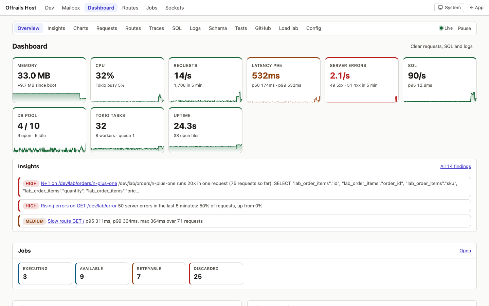

# dev-dashboard

Everything your app is doing, live, at **`/dev/dashboard`**: memory, CPU, requests per second, p50/p95/p99 latency, errors, the database pool and Tokio, as charts; every route with its numbers; every request as a trace waterfall; every SQL statement by fingerprint, with N+1 detection and EXPLAIN; the live log; an app doctor that turns all of it into ranked findings; a routes explorer that spots broken links and missing gates; the schema; your test runs on SQLite and Postgres; your CI; and a load lab to make the numbers move. Phoenix has LiveDashboard and Rails has rack-mini-profiler plus a handful of gems; this is one sample, in-process, with no Prometheus, Grafana or Jaeger to run. No dependency on other samples. Extracted from Rust off Rails apps.

- **Overview**: cards with sparklines (memory, CPU, req/s, latency, errors, SQL, pool, Tokio, uptime), the top insights, the slowest routes and queries, the latest traces and N+1s, and panels from other samples (the job queue when `jobs` is installed).
- **Charts**: ten live charts (SVG, light and dark), 5 min, 15 min, 1 h or 24 h, a hover readout, and a data table under each one as its text alternative.
- **Requests**: per matched route: hits, 2xx/3xx/4xx/5xx, p50/p95/p99/max, bytes, last hit, the slowest examples (each a trace).
- **Traces**: every request (the latest 300, plus the notable ones: a 5xx, an N+1, slower than 0.5 s) as a waterfall of its spans, SQL and events, linked to its queries. An `APP:` hook shows where an OpenTelemetry exporter plugs in.
- **SQL**: statements grouped by fingerprint (literals stripped): count, total, mean, p95, max, last seen, the routes that ran it, parameters as type and length only. The **N+1** list (the same statement more than 5 times in one request) with route and trace. **Writes during a GET.** **EXPLAIN** (SQLite `EXPLAIN QUERY PLAN`, Postgres `EXPLAIN`) for recorded SELECTs.
- **Logs**: a live tail over Server-Sent Events, requests and log lines together (like Phoenix's request logger), filtered by level, target and text, with pause and resume. Secret-looking fields are `[redacted]`.
- **Insights**: findings ranked by impact, each with its evidence, a fix, the framework guide that explains it and the page that proves it: N+1 hotspots, slow routes and queries, rising errors, foreign keys without an index, full scans from EXPLAIN, large or fast-growing tables, pending migrations, jobs that keep failing, memory that keeps growing, a saturated pool, slow renders, and **CSP violations** the browser reports. Dismiss one for the session. `APP:` hook for your own rules.
- **Routes**: the route table grouped by area and resource, with each handler's source file and line, its access level and middleware, live hits, error rate, p50/p95 and a sparkline, links to its traces and SQL, a Try it link, and the problems: 5xx or rising errors, slow, never hit, no test mentions it, a mutating route without CSRF, an admin or dev path without a gate, a GET that writes, **404s seen** with the route they probably meant and the page that linked there, overlapping patterns, routes missing from `docs/routes.md`.
- **Schema**: every table with its row count (and size on Postgres), columns and types, indexes, foreign keys, and the migrations. Never a row's data.
- **Tests**: `app test` (or the Run tests button) runs nextest on SQLite and Postgres with JUnit output; the page shows both side by side, the duration trend, the slowest tests, failures with their output, flaky tests, line coverage from llvm-cov, and which acceptance criteria in `product/` no test cites.
- **GitHub**: the app's CI runs with their success rate by day, open pull requests and issues, the latest release, open Dependabot alerts. Cached for a minute, never fetched at boot, the token never shown.
- **Load lab**: fake data through an `APP:` seed hook, a traffic generator against the app's own address (hard caps: 200 req/s, 60 s, 32 in flight), and six scenarios that light up a panel each: slow query, N+1, panic, memory spike, slow endpoint, error burst. `app bench --rps 50 --secs 10 --route /dev/lab/orders` from a terminal.
- **Config**: settings and the app's env vars with secrets redacted, OS and build info, and what the dashboard itself holds in memory.
- **For agents**: `/dev/dashboard.json` and a `dashboard` section in `/dev/introspect.json`.
- **It costs little**: about 1 µs per request for the middleware in a release build, 6 µs for a whole development request with its SQL recorded (see [How it works](#how-it-works)), fixed-size memory (a test pushes 20,000 requests and 5,000 statements through it and checks every bound), nothing at all outside development unless you turn on the production view.
- **Development only** by default (404 in production, proven by a test). Optionally a **read-only** subset at `/admin/dashboard` in production, behind the admin password or your admin accounts: no load lab, no EXPLAIN, no parameters, no logs.

Guides: [`.offrails/guides/dev-tools.md`](https://rustoffrails.org/docs/dev-tools) · [`errors-and-logging.md`](https://rustoffrails.org/docs/errors-and-logging) · [`database.md`](https://rustoffrails.org/docs/database) · [`testing.md`](https://rustoffrails.org/docs/testing) · [`security.md`](https://rustoffrails.org/docs/security).

## Screenshots

| Screen | Light | Dark |
|--------|-------|------|
| Overview | [desktop](../../docs/screenshots/dev-dashboard/overview-light-desktop.png) · [mobile](../../docs/screenshots/dev-dashboard/overview-light-mobile.png) | [desktop](../../docs/screenshots/dev-dashboard/overview-dark-desktop.png) · [mobile](../../docs/screenshots/dev-dashboard/overview-dark-mobile.png) |
| Charts | [desktop](../../docs/screenshots/dev-dashboard/charts-light-desktop.png) · [mobile](../../docs/screenshots/dev-dashboard/charts-light-mobile.png) | [desktop](../../docs/screenshots/dev-dashboard/charts-dark-desktop.png) · [mobile](../../docs/screenshots/dev-dashboard/charts-dark-mobile.png) |
| Insights | [desktop](../../docs/screenshots/dev-dashboard/insights-light-desktop.png) · [mobile](../../docs/screenshots/dev-dashboard/insights-light-mobile.png) | [desktop](../../docs/screenshots/dev-dashboard/insights-dark-desktop.png) · [mobile](../../docs/screenshots/dev-dashboard/insights-dark-mobile.png) |
| Requests | [desktop](../../docs/screenshots/dev-dashboard/requests-light-desktop.png) · [mobile](../../docs/screenshots/dev-dashboard/requests-light-mobile.png) | [desktop](../../docs/screenshots/dev-dashboard/requests-dark-desktop.png) · [mobile](../../docs/screenshots/dev-dashboard/requests-dark-mobile.png) |
| Routes explorer | [desktop](../../docs/screenshots/dev-dashboard/routes-light-desktop.png) · [mobile](../../docs/screenshots/dev-dashboard/routes-light-mobile.png) | [desktop](../../docs/screenshots/dev-dashboard/routes-dark-desktop.png) · [mobile](../../docs/screenshots/dev-dashboard/routes-dark-mobile.png) |
| Traces | [desktop](../../docs/screenshots/dev-dashboard/traces-light-desktop.png) · [mobile](../../docs/screenshots/dev-dashboard/traces-light-mobile.png) | [desktop](../../docs/screenshots/dev-dashboard/traces-dark-desktop.png) · [mobile](../../docs/screenshots/dev-dashboard/traces-dark-mobile.png) |
| Trace waterfall | [desktop](../../docs/screenshots/dev-dashboard/waterfall-light-desktop.png) · [mobile](../../docs/screenshots/dev-dashboard/waterfall-light-mobile.png) | [desktop](../../docs/screenshots/dev-dashboard/waterfall-dark-desktop.png) · [mobile](../../docs/screenshots/dev-dashboard/waterfall-dark-mobile.png) |
| SQL | [desktop](../../docs/screenshots/dev-dashboard/sql-light-desktop.png) · [mobile](../../docs/screenshots/dev-dashboard/sql-light-mobile.png) | [desktop](../../docs/screenshots/dev-dashboard/sql-dark-desktop.png) · [mobile](../../docs/screenshots/dev-dashboard/sql-dark-mobile.png) |
| N+1 | [desktop](../../docs/screenshots/dev-dashboard/n-plus-one-light-desktop.png) · [mobile](../../docs/screenshots/dev-dashboard/n-plus-one-light-mobile.png) | [desktop](../../docs/screenshots/dev-dashboard/n-plus-one-dark-desktop.png) · [mobile](../../docs/screenshots/dev-dashboard/n-plus-one-dark-mobile.png) |
| EXPLAIN | [desktop](../../docs/screenshots/dev-dashboard/explain-light-desktop.png) · [mobile](../../docs/screenshots/dev-dashboard/explain-light-mobile.png) | [desktop](../../docs/screenshots/dev-dashboard/explain-dark-desktop.png) · [mobile](../../docs/screenshots/dev-dashboard/explain-dark-mobile.png) |
| Logs | [desktop](../../docs/screenshots/dev-dashboard/logs-light-desktop.png) · [mobile](../../docs/screenshots/dev-dashboard/logs-light-mobile.png) | [desktop](../../docs/screenshots/dev-dashboard/logs-dark-desktop.png) · [mobile](../../docs/screenshots/dev-dashboard/logs-dark-mobile.png) |
| Schema | [desktop](../../docs/screenshots/dev-dashboard/schema-light-desktop.png) · [mobile](../../docs/screenshots/dev-dashboard/schema-light-mobile.png) | [desktop](../../docs/screenshots/dev-dashboard/schema-dark-desktop.png) · [mobile](../../docs/screenshots/dev-dashboard/schema-dark-mobile.png) |
| Tests | [desktop](../../docs/screenshots/dev-dashboard/tests-light-desktop.png) · [mobile](../../docs/screenshots/dev-dashboard/tests-light-mobile.png) | [desktop](../../docs/screenshots/dev-dashboard/tests-dark-desktop.png) · [mobile](../../docs/screenshots/dev-dashboard/tests-dark-mobile.png) |
| GitHub | [desktop](../../docs/screenshots/dev-dashboard/github-light-desktop.png) · [mobile](../../docs/screenshots/dev-dashboard/github-light-mobile.png) | [desktop](../../docs/screenshots/dev-dashboard/github-dark-desktop.png) · [mobile](../../docs/screenshots/dev-dashboard/github-dark-mobile.png) |
| Load lab, mid-run | [desktop](../../docs/screenshots/dev-dashboard/lab-running-light-desktop.png) · [mobile](../../docs/screenshots/dev-dashboard/lab-running-light-mobile.png) | [desktop](../../docs/screenshots/dev-dashboard/lab-running-dark-desktop.png) · [mobile](../../docs/screenshots/dev-dashboard/lab-running-dark-mobile.png) |
| Config | [desktop](../../docs/screenshots/dev-dashboard/config-light-desktop.png) · [mobile](../../docs/screenshots/dev-dashboard/config-light-mobile.png) | [desktop](../../docs/screenshots/dev-dashboard/config-dark-desktop.png) · [mobile](../../docs/screenshots/dev-dashboard/config-dark-mobile.png) |
| Forced dark on a light system | [desktop](../../docs/screenshots/dev-dashboard/forced-dark-light-desktop.png) · [mobile](../../docs/screenshots/dev-dashboard/forced-dark-light-mobile.png) | |

All data in them is synthetic: fake orders, `example.com` customers, a fixture repository `example-org/example-app`, synthetic test runs; the host name is redacted.

## Install

Through the samples MCP server: `get_sample dev-dashboard`. Or by hand, in the app root:

1. Crates (`cargo add`, never with a version): `sysinfo --no-default-features --features system`, `quick-xml`, `reqwest --no-default-features --features rustls,json,http2`, `tower --features util`.
2. Copy `files/` into the app, keeping the paths (`.config/nextest.toml` included). In the test file and the `main.rs` wiring, replace `offrails_host` with your crate name.
3. Wiring (each at its `samples: <anchor>` comment when the app has one; otherwise at the spot described):
   - `src/kernel/mod.rs`: `pub mod dashboard;`.
   - `migration/src/lib.rs`: `mod m20261016_000600_create_lab_orders;` and `Box::new(m20261016_000600_create_lab_orders::Migration)` (the load lab's fake orders).
   - `src/config.rs`: a `dashboard: DashboardConfig` field (in the struct, `Debug`, `from_env`, `test()`), and the `DashboardConfig` section with `valid_repo` and `shown_env` (the text is in `sample.toml`).
   - `src/state.rs`, in `AppState::new` before the state is built: `let db = crate::kernel::dashboard::instrument(db, &config);` (the SQL callback must be set before the connection is cloned).
   - `src/routes.rs`: mount `/admin/dashboard` behind `DashboardAccess` when `access::admin_mounted(&config)`; inside `if config.is_development() { … }` merge `web::dev_router()`; in the outermost layers, just inside `SetRequestIdLayer`, `.layer(from_fn(crate::kernel::dashboard::http::middleware))`; a `paths::dev_dashboard()` helper; the `ROUTES` rows (`Access::Dev` for `/dev/…`, `Access::Admin` for `/admin/dashboard/…`).
   - `src/kernel/ui.rs`: the Dashboard and Routes tabs, and `"system"` and `"routes"` in `HIDDEN_TABS` (the dashboard replaces them; their pages stay as the fallback).
   - `src/kernel/security.rs`: `"report-uri /dev/csp-reports"` in `DEV_CSP_EXTRA` (development's CSP only).
   - `src/controllers/dev.rs`: the Dashboard tile. `src/kernel/introspect.rs`: `out["dashboard"]`.
   - `src/main.rs`: `Box::new(kernel::dashboard::trace::DashboardLayer)` in the tracing layers; `kernel::dashboard::serve_started(&state);` where `serve` starts; the `Bench`, `Test` and `Dashboard` subcommands and their dispatch arms.
   - `templates/layouts/application.html`: a footer link `<a href="{{ paths::dev_dashboard() }}" hx-boost="false" class="link">Dashboard</a>`.
   - `.env.example`: `GITHUB_REPO`, `GITHUB_TOKEN`, `DASHBOARD_IN_PRODUCTION`.
   - `tests/app/main.rs`: `mod dev_dashboard_test;`; `security_test.rs` router sources: `src/kernel/dashboard/web.rs`, `src/kernel/dashboard/lab.rs`; `kernel_web_test.rs` no-store paths; `theme_switch_test.rs` kernel pages.
4. `cargo fmt --all && cargo run -- db migrate && cargo run -- routes`, then the Definition of Done.

`tools/install.sh dev-dashboard <app>` does steps 1 to 3.

## After installing

- Open `/dev/dashboard/lab`, press **N+1**, and follow the link: that is the tour. `cargo run -- dashboard demo` adds fake orders and a history of synthetic test runs; `cargo run -- dashboard warmup --url http://localhost:3000` drives a minute of mixed traffic and every scenario.
- `docs/decisions.md`: `YYYY-MM-DD: installed the dev-dashboard sample (in-process metrics, traces, SQL, insights, load lab; development only)`; and the crates it added.
- `.env`: `GITHUB_REPO=owner/name` (and optionally a read-only `GITHUB_TOKEN`) for the GitHub page; `TEST_DATABASE_URL` for Run tests on Postgres.
- `app test` replaces nothing in CI: CI keeps running `cargo nextest run` on both databases. Run `app test` locally to see the runs on the Tests page.
- A test that builds `TestApp` with a development config and counts queries: the dashboard's SQL callback replaces `TestApp`'s counter in development (SeaORM keeps one callback). Read `HUB.sql` there, or use the test config.

## Adapting it

- **Load-test your own pages**: point `lab::seed` (`// APP:` in `kernel/dashboard/lab.rs`) at your models, then put your routes in the Traffic form or `app bench --route`. Drop the `lab_orders` tables with a new migration when you no longer need them.
- **A panel for your own subsystem** (realtime, a payment queue): implement `PanelProvider` and add it to `providers()` (`// APP:` in `kernel/dashboard/panels.rs`; the realtime example is in its header).
- **Your own insight rules**: return findings from `custom_rules` (`// APP:` in `kernel/dashboard/insights.rs`); tune the thresholds at the top of that file (slow route p95, slow query p95, table sizes).
- **The dashboard in production, read-only**: `DASHBOARD_IN_PRODUCTION=true` and `APP_ADMIN_PASSWORD` (16+ characters), or set `HAS_ACCOUNTS` and `admin_from_session` (`// APP:` in `kernel/dashboard/access.rs`) to use your admin accounts. It records in production then (a few µs per request).
- **Send traces to a collector**: set `OTLP_EXPORT` and fill `export` (`// APP:` in `kernel/dashboard/trace.rs`) with the opentelemetry crates.
- **More history or a smaller footprint**: `RECENT`, `NOTABLE`, `LOG_LINES` (`trace.rs`), `MAX_FINGERPRINTS` (`sql.rs`), `N_PLUS_ONE` and `IGNORED` (`http.rs`), `MAX_RPS`/`MAX_SECS` (`lab.rs`); every one is `// APP:`.

## Do not change

- Dev routes exist only in development; `/admin/dashboard` only with an admin gate (`the_dashboard_is_404_in_production_by_default`, `the_production_dashboard_needs_the_admin_password`).
- Parameters show as type and length, never values; EXPLAIN only for SELECTs (`sql_parameter_values_never_reach_any_page`, `explain_runs_for_selects_only`).
- The traffic generator takes paths, never URLs (`traffic_only_targets_this_app`).
- Every ring and map has a fixed size; the unmatched-path bucket is one bucket (`the_dashboard_stays_within_its_memory_bound`).
- The GitHub token stays in its header (`the_github_token_is_never_shown_or_logged`).
- `no_store()` on both routers (`every_dashboard_response_is_no_store`).
- The CSRF probe uses a method the route doesn't have, so it never runs a handler (`a_mutating_route_without_csrf_is_spotted`).
- Styles live in `static/kernel/dashboard.css` with `light-dark()` tokens, never in `assets/app.css` (`every_dashboard_page_renders_with_its_own_assets`, `the_dashboard_stylesheet_follows_the_theme_switch`).

## How it works

Everything is in this process, in one hub (`kernel/dashboard/mod.rs`, `HUB`) of fixed-size rings and maps:

| Part | Hooks in at | Records |
|------|-------------|---------|
| `http.rs` | a middleware at the router's outermost layer (outside the panic and timeout layers) | per `ROUTES` pattern: count, status classes, a log-bucketed latency histogram, bytes, the 3 slowest traces, per-minute history; 404 paths; writes during a GET |
| `sql.rs` | SeaORM's `set_metric_callback` (sea-orm 2.0.4), installed in `AppState::new` | per fingerprint: count, histogram, routes, redacted parameters; per request: every statement for the trace and the N+1 count |
| `trace.rs` | a `tracing-subscriber` layer in `main.rs` | spans and events of each request (its trace), every log line (the live tail) |
| `collector.rs` | a task `serve` starts | once a second: RSS, virtual memory, CPU (sysinfo), open files, Tokio (workers, alive tasks, global queue, busy time; more with `--cfg tokio_unstable`), the pool (size, idle, max; sqlx doesn't count waiters, so saturation is "no idle connection at max size"), requests and SQL; 15 min at 1 s, 24 h at 1 min |
| `insights.rs`, `route_explorer.rs`, `schema.rs` | the above, the database catalog, CSP reports | findings, route problems, the schema |

A request's context lives in a Tokio task-local while it runs, so the SQL callback and the tracing layer attach to it without passing anything around. The dashboard's own pages and streams run "quietly" and record nothing. Charts are SVG rendered on the server (one implementation, works without JavaScript, nothing to vendor, the strict CSP untouched); `dashboard.js` swaps in re-rendered fragments from a Server-Sent Events stream (every 5 s with `prefers-reduced-motion`, never while the tab is hidden) and adds the hover readout.

**Overhead**, measured by `the_middleware_overhead_is_small` (a trivial route behind the middleware alone, recording on and off on alternate requests, compared by median over 3,600 requests): **1.2 µs per request in a release build**, about 5 µs in a debug build; the test fails above 10 µs (release) or 50 µs (debug). A whole development request through every layer, with its SQL recorded and its trace and log line written, measured 6.3 µs more (97 → 103 µs for a static page, release). With the dashboard off (production by default, and tests) the middleware checks one atomic flag.

| Route | Does |
|-------|------|
| `GET /dev/dashboard` | the overview |
| `GET /dev/dashboard/{charts,requests,routes,traces,sql,logs,insights,schema,tests,github,lab,config}` | the pages |
| `GET /dev/dashboard/traces/{id}`, `/sql/{id}` | a trace's waterfall; a statement with its plan and requests |
| `POST /dev/dashboard/sql/{id}/explain` | EXPLAIN a recorded SELECT |
| `GET /dev/dashboard/stream?view=…`, `/logs/stream?level=&target=&q=` | Server-Sent Events: fragments, log lines |
| `POST /dev/dashboard/lab/{seed,clear,traffic,stop,scenario}`, `/tests/run`, `/insights/dismiss`, `/reset` | actions (CSRF applies), each redirecting with a flash |
| `POST /dev/csp-reports` | the CSP `report-uri` (development only) |
| `GET /dev/lab/{orders,orders/n-plus-one,slow-query,slow,panic,error}` | the lab's demo routes |
| `GET /dev/dashboard.json` | the numbers, for agents |
| `GET /admin/dashboard/{,charts,requests,traces,traces/{id},sql,sql/{id},config,stream}` | the read-only view |

## Files

| File | What |
|------|------|
| `src/kernel/dashboard/mod.rs` | the hub, `instrument`, `serve_started`, `snapshot` |
| `src/kernel/dashboard/http.rs` | the middleware, route matching, per-route stats, 404s, writes during a GET |
| `src/kernel/dashboard/sql.rs` | the SQL callback, fingerprints, redaction, N+1, EXPLAIN |
| `src/kernel/dashboard/trace.rs` | the tracing layer, traces, the log ring, the waterfall, the OTLP hook |
| `src/kernel/dashboard/collector.rs`, `series.rs`, `hist.rs` | the once-a-second sampler, the rings, the histogram |
| `src/kernel/dashboard/charts.rs` | chart geometry (SVG) and text alternatives |
| `src/kernel/dashboard/insights.rs`, `route_explorer.rs`, `schema.rs`, `panels.rs` | findings, route detectors, the catalog, provider panels |
| `src/kernel/dashboard/lab.rs`, `cli.rs` | the load lab, `app bench`, `app test`, `app dashboard` |
| `src/kernel/dashboard/testruns.rs`, `github.rs` | test runs (JUnit, nextest), the GitHub client |
| `src/kernel/dashboard/web.rs`, `access.rs` | routers, pages, streams; the production gate |
| `migration/src/m20261016_000600_create_lab_orders.rs` | the lab's fake orders |
| `templates/kernel/dashboard/*.html` | the pages and fragments |
| `static/kernel/dashboard.css`, `dashboard.js` | its own styles and behavior |
| `.config/nextest.toml` | the `dashboard` profile (JUnit, one retry) |
| `tests/app/dev_dashboard_test.rs`, `tests/fixtures/github/*.json` | the tests named in `CHECKS.md`; a recorded GitHub API |
